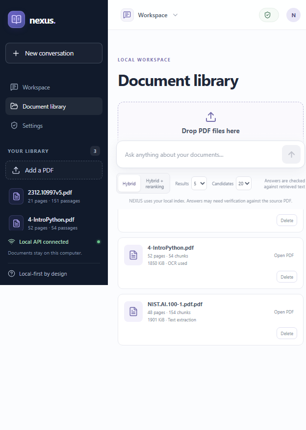
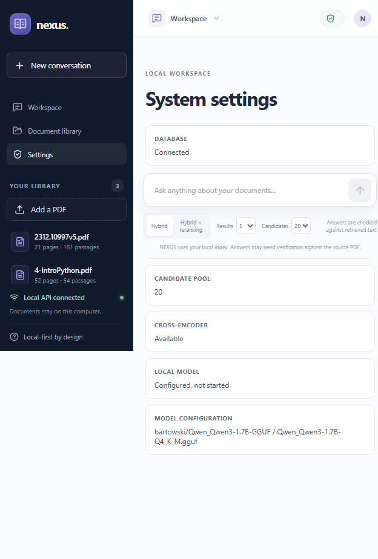
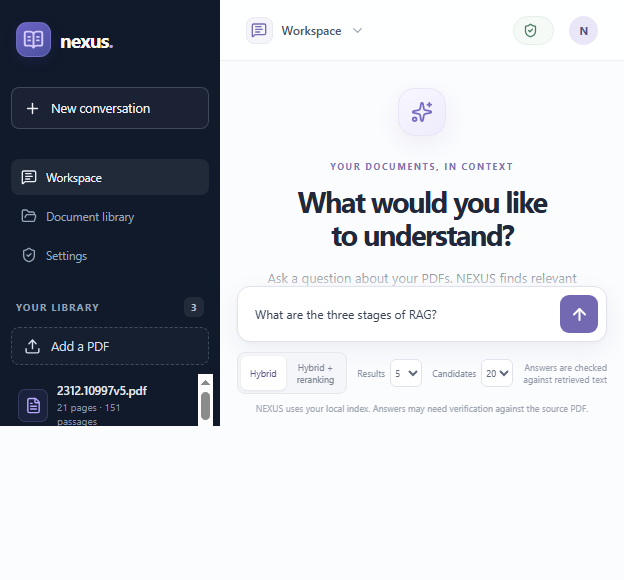

# PDF text ingestion

## NEXUS local application

NEXUS RAG is a local-first PDF knowledge platform for indexing, retrieval,
citation, and evidence-checked answers.

### Prerequisites

- Windows 10 x64 or newer
- Python 3.11 or 3.13
- Node.js 20 or newer
- Optional: Tesseract OCR and OCR language data for scanned PDFs
- Optional: a compatible CPU build of llama.cpp for real LLM answers

### Verified fresh-install flow

```powershell
git clone https://github.com/mdashiq2008-ops/nexus-rag.git
cd nexus-rag

py -m venv .venv
.\.venv\Scripts\Activate.ps1
python -m pip install --upgrade pip
python -m pip install -r requirements.txt

python -m uvicorn api:app --host 127.0.0.1 --port 8000
```

In a second PowerShell:

```powershell
cd nexus-rag\frontend
npm.cmd ci
npm.cmd run dev -- --host 127.0.0.1 --port 5173
```

Open `http://127.0.0.1:5173/`. The backend API is available only on
`127.0.0.1:8000`.

After installation, Windows users can start both services with:

```powershell
.\start-nexus.bat
```

### Example questions

- "What are the three stages of RAG?"
- "Summarize the key ideas in my documents."
- "What does the NIST AI RMF say about measurement?"
- "Compare the recommendations across the uploaded PDFs."
- "What evidence supports the conclusions on page 2?"

### Interface screenshots








The React interface is in `frontend/`; the FastAPI backend is in `api.py`.
The interface provides the workspace, document library, upload/delete actions,
PDF citation links, hybrid retrieval controls, and system status.

Start the backend:

```powershell
python -m pip install -r requirements.txt
python -m uvicorn api:app --host 127.0.0.1 --port 8000
```

Start the frontend in a second PowerShell:

```powershell
cd frontend
npm.cmd install
npm.cmd run dev
```

Open `http://localhost:5173`. The API remains bound to `127.0.0.1`.

The `/api/chat` request accepts `question`, `search_mode`, `top_k`,
`candidate_k`, `max_context_tokens`, and `rerank_threads`. Example:

```json
{
  "question": "What are the stages of RAG?",
  "search_mode": "hybrid_rerank",
  "top_k": 5,
  "candidate_k": 20,
  "max_context_tokens": 2500,
  "rerank_threads": 2
}
```

Use extractive mode without starting a large language model. The optional
llama.cpp adapter is reported honestly through `/api/health` and `/api/status`
and is not started automatically.

### Security

- The API binds to `127.0.0.1` by default and is restricted to local Vite origins.
- Uploads are limited to 50 MiB and must have a `.pdf` filename and PDF content.
- Filenames are sanitized; managed files are stored under the configured uploads directory.
- Document deletion cascades database rows and embeddings and only removes files that
  resolve inside the managed uploads directory.
- PDF serving and deletion require a SHA-256 document identifier.
- PDF content is treated as untrusted evidence and is never executed.
- No dependency secret or external-provider credential is required for extractive mode.

Fresh dependency checks: `pip-audit` reported no known vulnerabilities and
`npm audit` reported zero vulnerabilities.

Install the Python dependencies with `python -m pip install -r requirements.txt`.
Scanned pages use PyMuPDF OCR and require the Tesseract OCR executable and the
requested language data to be installed separately and available on `PATH`.
Local semantic embeddings use FastEmbed and the
`sentence-transformers/all-MiniLM-L6-v2` model. The model is downloaded the
first time it is needed; PDF text and search queries are then embedded on this
computer and are not sent to an embedding API. Model files are cached under
`%LOCALAPPDATA%\fastembed_cache`.

Ingest one or more PDFs into a local SQLite database:

```powershell
python step1.py document-a.pdf document-b.pdf --database chunks.sqlite3
```

Search stored chunks:

```powershell
python step1.py --search "How do Python functions work?" --database chunks.sqlite3
```

There are three retrieval modes. Semantic search is the default and uses the local
embedding model. To use SQLite FTS5 keyword search ranked by BM25 instead:

```powershell
python step1.py --search "variable name" --search-mode bm25 --database chunks.sqlite3
```

Hybrid search combines semantic and BM25 rankings with Reciprocal Rank Fusion
(RRF), which can reward chunks that rank well in both. By default it retrieves
20 candidates from each engine before fusion. `--candidate-k` controls how many
fused candidates are considered, and `--top-k` controls how many final results
are returned. Use 20 for normal searches and 40 when broader candidate coverage
is worth the additional reranking cost:

```powershell
python step1.py --search "variable name" --search-mode hybrid --database chunks.sqlite3
python step1.py --search "variable name" --search-mode hybrid --candidate-k 40 --database chunks.sqlite3
```

To rerank hybrid candidates with a local cross-encoder:

```powershell
python step1.py --search "variable name" --search-mode hybrid --rerank --database chunks.sqlite3
```

The cross-encoder model (`Xenova/ms-marco-MiniLM-L-6-v2`) is downloaded on first
use and cached locally. Hybrid search without `--rerank` continues to use RRF
alone. Both modes preserve the PDF filename, page, character offsets, and OCR
metadata in the returned results. Reranking runs locally; query and passage
text are not sent to a remote inference service. The measured defaults are
batch size 1 and 2 ONNX threads; `--rerank-threads` can override the thread
count.

FTS5 is built into the configured SQLite runtime and uses the existing chunks
table; it needs no additional Python package or search server. The first run
builds the FTS index for existing chunks, and future chunk inserts/updates are
kept in sync automatically. BM25 matches query terms, so exact words and names
are useful; semantic search can better match related wording.

For interactive search, run `ask.bat` from the project folder (or double-click
it). Once it says `Ask a question:`, type a question and press Enter. Keep
asking questions until you type `exit` or `quit`. This uses the project's
`pdf_chunks.sqlite3` database.
To start the interactive prompt with keyword/BM25 ranking, run
`.\ask.bat --search-mode bm25`. A BM25 score closer to zero ranks lower;
more-negative scores rank higher.
For hybrid ranking, run `.\ask.bat --search-mode hybrid`.

The first search on the existing database automatically creates embeddings for
chunks that do not have them. To rebuild all stored vectors:

```powershell
python step1.py --reindex --database chunks.sqlite3
```

The script skips files whose SHA-256 hash is already stored. Chunk rows retain
the source document hash, page number, and character offsets in the cleaned
page text; the `ocr_used` column indicates whether OCR was used. Chunk size
defaults to 1,000 characters with 150 characters of overlap.

Search results show the source PDF, page, text offsets, and OCR status. Semantic
results use a similarity score; hybrid results use an RRF score unless
cross-encoder reranking is enabled. Cross-encoder scores are raw relevance
scores for ordering passages, not percentages or calibrated confidence
probabilities. Review the cited page in the PDF when a precise quotation or
high-stakes answer is needed; OCR and PDF layout extraction can still make
mistakes.

## Retrieval evaluation

The manually labeled benchmark contains 50 questions over three technical
PDFs. Each target identifies the PDF, one-based page number, and cleaned-text
character offsets. The personal bank statement in the Downloads folder is
intentionally excluded. Source hashes are checked so labels cannot silently
drift to different document versions.

Run both hybrid configurations with candidate counts 10, 20, and 40:

```powershell
python evaluate_retrieval.py --pdf-dir C:\Users\SONY\Downloads --output benchmarks\retrieval_candidate_sweep_results.json
```

The evaluator builds an in-memory database, verifies all annotated passages,
and compares RRF alone with RRF plus the local cross-encoder for each candidate
count. It batches query-passage pairs across the question set (batch size 1 and
2 ONNX threads by default) and reports Recall@5, MRR@5, graded nDCG@5, Top-1
accuracy, and latency. `--candidate-k` may be repeated to select a custom
sweep, while `--batch-size` and `--threads` override inference settings:

```powershell
python evaluate_retrieval.py --pdf-dir C:\Users\SONY\Downloads --candidate-k 20 --candidate-k 40 --batch-size 32
```

Tune ONNX batch size and CPU threads on a fixed sample from all 50 benchmark
questions:

```powershell
python tune_reranker.py --pdf-dir C:\Users\SONY\Downloads
```

The tuner tests batch sizes 1, 2, 4, 8, and 16 with 1, 2, and 4 ONNX threads.
Each configuration runs in a separate process so peak working-set memory is
measured independently. It uses one top RRF passage for each benchmark
question, holds those 50 query-passage pairs constant across configurations,
and writes timings and memory results to
`benchmarks/reranker_tuning_results.json`. Use the best measured settings for the full sweep (currently batch size 1 and
2 threads on the tested machine):

```powershell
python evaluate_retrieval.py --pdf-dir C:\Users\SONY\Downloads --batch-size 1 --threads 2 --output benchmarks\retrieval_candidate_sweep_optimized_results.json
```

The results include mean dense-search, BM25, and RRF fusion times per query,
plus total tokenization and ONNX inference time for each reranking batch.
Reranked per-query latency apportions the measured batch wall time by each
question's candidate-pair count; the full batch wall time is also reported.
Model loading and indexing are timed separately and excluded from search
latency. Benchmark questions and passage labels are in
`benchmarks/retrieval_benchmark.json`; detailed ranked PDF pages and character
offsets are written to the results JSON.

For regular searches, `--rerank-threads` sets the same ONNX thread count, e.g.
`--rerank --rerank-threads 2`.

### NEXUS v1.0.0 performance record

Measured on the development Windows computer with the cached
`Qwen_Qwen3-1.7B-Q4_K_M.gguf` model and CPU inference:

| Operation | Measured time | Peak working set |
|---|---:|---:|
| llama-server startup | 65.314 seconds | Part of the run |
| Answer generation | 35.042 seconds | Part of the run |
| Full Qwen run | - | 1395.5 MiB |

Startup and answer timing vary with CPU, RAM, thermal conditions, model cache,
and context size. NEXUS does not start llama.cpp or download the 1.223 GiB
model during application startup; extractive answers remain available.

## Context construction

`context_builder.py` converts ranked `SearchResult` objects into a structured
`ContextBundle` for a later answer-generation step. It removes duplicate text,
merges same-page chunks when their source offsets overlap consistently, keeps
PDF/page/character/OCR citations and original chunk IDs, and fills the token
budget in retrieval-rank order. An oversized passage is clipped to fit the
remaining budget; its source citation remains attached. The budget counts the
serialized context, including citation headers.

Callers must supply the selected model's token counter rather than relying on
a misleading generic estimate:

```python
from context_builder import build_context

context = build_context(
    ranked_results,
    max_tokens=3000,
    token_counter=lambda text: len(llm_tokenizer.encode(text)),
)
llm_input = context.to_dict()
```

## Grounded answer generation

`answer_generation.py` provides a provider-agnostic answer core. Pass it a
generator callable for the locally selected LLM. The generator is asked for
extractive statements, each copied verbatim from a supplied passage. The core
rejects paraphrases, unknown passage IDs, and malformed responses; it creates
citation IDs from the actual PDF/page/offset/chunk metadata rather than
accepting citation text from the model. Empty retrieval or an explicit
`insufficient_evidence` response produces a fixed abstention.

The included [qwen3_llama_cpp.py](</F:/nexus personal rag/qwen3_llama_cpp.py>)
adapter runs Qwen3-1.7B Q4_K_M through a local CPU `llama-server` OpenAI-
compatible endpoint. This Windows setup defaults to
`C:\Users\SONY\AppData\Local\nexus-rag\llama.cpp\b12503\llama-server.exe`.
Set `server_executable` in `Qwen3LlamaCppConfig` to your own executable path
or to `llama-server` if it is on `PATH`. On first use, the server downloads the GGUF from
[Hugging Face](https://huggingface.co/bartowski/Qwen_Qwen3-1.7B-GGUF)
(approximately 1.28 GB) and caches it. The API binds to `127.0.0.1`; prompts
and PDF passages are not sent to a remote inference service.

```python
from answer_generation import answer_question
from qwen3_llama_cpp import Qwen3LlamaCppConfig, Qwen3LlamaCppGenerator

generator = Qwen3LlamaCppGenerator(
    Qwen3LlamaCppConfig(
        context_size=4096,
        threads=2,
        max_tokens=256,
    )
)

answer = answer_question(
    question,
    ranked_results,
    generator=generator,
    max_context_tokens=3000,
    token_counter=lambda text: len(llm_tokenizer.encode(text)),
)
print(answer.answer)
for citation in answer.citations:
    print(
        citation.citation_id,
        citation.source.filename,
        citation.source.page_number,
        citation.source.chunk_ids,
    )
```

The default server is started on first generation and stopped after each
answer to release memory. Set `keep_server_running=True` to reuse a loaded
model, then call `generator.close()` when finished. If reranking is enabled,
release the cross-encoder after retrieval and before answer generation:

```python
ranked_results = search_chunks_hybrid(
    connection,
    question,
    reranker=reranker,
)
reranker.close()
```

The default CPU backend uses two threads, disables GPU layers, and limits
context to 4,096 tokens. Repository, GGUF filename, executable path, cache
directory, context size, thread count, output limit, and server lifecycle are
configurable through `Qwen3LlamaCppConfig`.

The answer core is deliberately extractive: it fails closed rather than
displaying a generated paraphrase it cannot verify. The context-token budget
applies to the serialized evidence context; callers should reserve additional
tokens for the prompt and answer in their chosen model's context window.

## Streamlit interface

Install the requirements, then start the local interface:

```powershell
python -m pip install -r requirements.txt
python -m streamlit run streamlit_app.py
```

The app supports PDF upload, index management, Hybrid or Hybrid + Reranking
search, and grounded Qwen answers. Answer text is labeled as local
LLM-generated and validated as verbatim extractive evidence; insufficient
evidence produces an explicit abstention. Citation buttons open the cited page
in an embedded PDF preview. Uploaded PDFs are kept under
`%LOCALAPPDATA%\nexus-rag\streamlit-uploads`; removing a document from the index
does not delete an original file unless it is an app-managed upload and that
option is selected. Set `NEXUS_DATABASE_PATH` to use a different SQLite index.

## Local React and FastAPI interface

The React interface uses the same local PDF index and extractive answer
pipeline. Start the API and frontend in separate PowerShell terminals from the
project directory:

```powershell
python -m uvicorn api:app --host 127.0.0.1 --port 8000
```

```powershell
Set-Location .\frontend
& "$env:ProgramFiles\nodejs\npm.cmd" install
& "$env:ProgramFiles\nodejs\npm.cmd" run dev
```

Open the local Vite URL printed in the frontend terminal. During development,
Vite proxies `/api` requests to `http://127.0.0.1:8000`. The interface supports
PDF upload, index management, Hybrid or Hybrid + Reranking search, extractive
answers, insufficient-evidence messages, source previews, and links to cited
PDF pages. Reranking loads the local cross-encoder and can use additional CPU
and memory.

This frontend is intended to run on the same computer as the API. A deployed
Lovable-hosted page cannot access this computer's local API automatically; do
not upload private PDFs or workspace code to Lovable as part of this local
workflow.

## End-to-end RAG pipeline

`rag_pipeline.py` connects hybrid retrieval, optional cross-encoder reranking,
context construction, evidence validation, and Qwen answer generation:

```powershell
python rag_pipeline.py "What does the document say about retrieval?" --database pdf_chunks.sqlite3
```

The defaults return five passages, fuse up to 20 candidates, rerank them, and
limit the serialized evidence context to 2,500 Qwen tokens. Use `--no-rerank`
to skip the cross-encoder, or tune `--top-k`, `--candidate-k`,
`--max-context-tokens`, and `--rerank-threads`. The pipeline counts context
tokens through the local llama.cpp tokenizer, closes the cross-encoder before
starting answer generation, and prints citations from retrieved PDF metadata.
